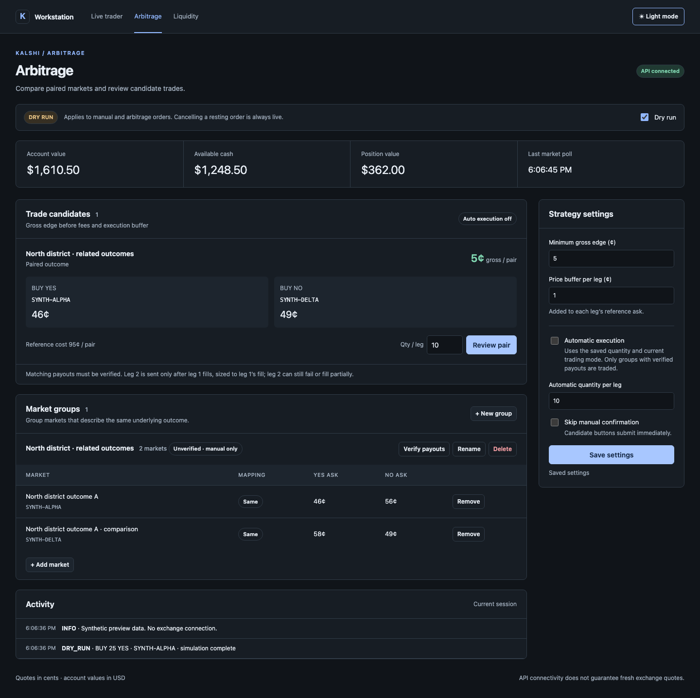
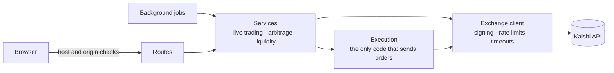

# Kalshi Workstation

A browser-based workstation for trading [Kalshi](https://kalshi.com) prediction markets, run locally with your own API key.

**Docs:** [Arbitrage](docs/arbitrage.md) · [Liquidity rewards](docs/liquidity-rewards.md) · [Design decisions](docs/design-decisions.md)

## Overview

The workstation has three pages: a manual trader for one event when attending live, an arbitrage watcher for groups of markets you define that can execute both legs of a contract pair, and a monitor for Kalshi's liquidity incentive program.

We began working on this service in October 2025 to use ourselves while attending Georgia Tech football games, trading live in the stands to make a profit. Since then, we've expanded the service to support other methods of making money on Kalshi, including an arbitrage wing and liquidity management pages.

> [!WARNING]
> This software places real orders. Start on Kalshi's demo exchange in dry run (both are the defaults). It is MIT-licensed and provided without warranty. It is not affiliated with Kalshi and is not financial advice.


<sub>The arbitrage workspace (synthetic data).</sub>

## Features

**Live trader** (`/`)
- Live quotes (YES and NO, bid and ask) for every market in one event; the server refreshes them twice a second and the page redraws every 2 seconds
- An order ticket per market: pick a side and quantity, then buy or sell immediately (immediate-or-cancel) with a limit price 10¢ through the current quote
- Positions with average price, fees paid, and liquidation value
- Resting orders with their queue position, and a confirmed cancel

**Arbitrage** (`/arbitrage`)
- Groups of markets you believe ask the same question, including markets phrased the opposite way
- The best pair in each group whose combined price is under $1 by at least your threshold
- Two-leg execution where the second leg is sized to what the first actually filled, and any shortfall is reported as unhedged
- Optional automatic execution, limited to groups whose payouts a person has verified
- [How it works →](docs/arbitrage.md)

**Liquidity** (`/liquidity`)
- Every resting order on the account, flagged by how exposed it is (only quote, next to fill, at top) with its estimated daily reward
- One-click requeue that moves an order to the back of its price level
- A scanner that ranks the incentive program's markets by what a new order could earn
- [How rewards are estimated →](docs/liquidity-rewards.md)

**Every page**
- Dry run on by default, with a switch on the trading pages; dry run still uses live quotes
- Cash, position value, and total on the trading pages, from one shared balance feed
- Confirmation before switching to live orders, enabling automation, verifying a group, executing a pair, or cancelling an order
- Light and dark themes; works at phone width

## Project structure



```text
src/kalshi_workstation/
  app.py              creates the services; wires routes, middleware, and extensions
  runtime.py          starts and stops background jobs; logging
  config.py           environment variables
  features/
    live_trading/     service.py (state and polling), routes.py
    arbitrage/        analysis.py (pure pricing), execution.py (two legs), service.py, routes.py
    liquidity_monitor/  analysis.py (reward ranking), routes.py
  core/
    exchange/         kalshi.py (signed, rate-limited HTTP), programs.py (incentive catalog)
    execution/        service.py (order submission), orders.py (encoding), mode.py (dry run)
    security.py       cross-site and host checks
    liquidity.py      incentive scoring model
    portfolio.py      shared balance cache
    prices.py         cents conversion and fee estimate
    persistence.py    atomic settings writes
  extensions/         optional add-ons, loaded by convention
server.py             launcher for python server.py
static/               pages and their scripts (no build step)
tests/                unit, integration, and browser checks
docs/                 longer explanations, linked above
```

## Environment setup

You need Python 3.11+ and a Kalshi API key. Create the key in your Kalshi account settings and save its private key file somewhere outside the repository. Start with a key from Kalshi's demo exchange, which trades with play money.

```bash
python3.11 -m venv .venv && source .venv/bin/activate
pip install -e '.[dev]'
cp -n .env.example .env     # then fill in your key ID, key file path, and an event ticker
```

| Variable | Default | Meaning |
| --- | --- | --- |
| `ENV` | `DEMO` | Exchange: `DEMO` or `PROD` |
| `DRY_RUN` | `true` | Simulate manual and arbitrage orders; only `false` sends them |
| `DEMO_KEYID`, `DEMO_KEYFILE` | | API key ID and the path to its private key, absolute or relative to the repository root (`PROD_…` for production) |
| `EVENT_TICKER` | | Event shown in the live trader |
| `KALSHI_DATA_DIR` | repository root | Existing directory where settings are saved |
| `KALSHI_ALLOWED_HOSTS` | `localhost,127.0.0.1` | Host names your browser may use to reach the server |
| `KALSHI_READS_PER_SECOND`, `KALSHI_WRITES_PER_SECOND` | `15`, `8` | Request budgets; raise only for a higher API tier |
| `KALSHI_LOG_LEVEL` | `INFO` | Server log level |

Dry run still reads live market data, so it needs credentials.

## Running the server

```bash
uvicorn kalshi_workstation.app:app --host 127.0.0.1 --port 8000
```

`python server.py` starts the same app on the same address. Open <http://127.0.0.1:8000>. Run a single worker, because extra workers would run every background job twice. Keep the server on `127.0.0.1`, since it has no login.

With Docker, set the key path in `.env` to the path inside the container (for example `DEMO_KEYFILE=/keys/demo.pem`):

```bash
docker build -t kalshi-workstation .
docker run --rm -p 127.0.0.1:8000:8000 --env-file .env \
  -v ~/kalshi-keys:/keys:ro -v "$PWD/data:/data" -e KALSHI_DATA_DIR=/data \
  kalshi-workstation
```

## Core logic

### Kalshi in one paragraph

A Kalshi contract asks a yes/no question and pays **$1 if the answer is yes, $0 if no**, so its price (1¢ to 99¢) reads as a probability. YES and NO mirror each other: buying NO at 38¢ is the same position as selling YES at 62¢, and Kalshi keeps one order book per market in YES terms. Takers pay a fee of about `0.07 × P × (1 − P)` per contract, which is 1.75¢ at 50¢.

### Signing and polling

Every request to Kalshi is signed with your account's RSA private key: an RSA-PSS (SHA-256) signature over the timestamp, method, and path, sent in `KALSHI-ACCESS-*` headers. The key file is read locally the first time it's needed and never leaves your machine.

The server keeps market state fresh with background jobs. The trader and arbitrage pages redraw from the server's in-memory copy every 2 seconds, so a second tab doesn't add exchange requests, and orders are priced from quotes at most half a second old:

| Job | Refresh | Feeds |
| --- | --- | --- |
| Event markets and positions | 0.5 s | Live trader |
| Resting orders | 3 s | Live trader |
| Arbitrage group quotes (one batched request) | 0.5 s | Arbitrage |
| Balance | 2 s | Trader and arbitrage |
| Incentive program list | 5 min | Liquidity |

### Finding a pair

If two markets ask the same question, YES on one and NO on the other always pay out exactly $1 between them. When their asks add up to 95¢, buying both locks in 5¢ per pair before fees. You define the groups of markets that should behave this way, and the app checks every pair in each group twice a second.

Prices can't tell you whether two payouts actually cancel, though. Here is the same arithmetic on two markets that only look related:

| If the tournament winner is | YES "Spain wins" (20¢) | NO "Argentina wins" (75¢) | The pair pays |
| --- | --- | --- | --- |
| Spain | $1 | $1 | $2 |
| Argentina | $0 | $0 | **$0** |
| Anyone else | $0 | $1 | $1 |

The pair costs 95¢ and usually returns at least $1, but if Argentina wins, both contracts expire worthless. Whether two contracts are complements depends on their settlement rules, which the app can't read. So automatic execution only trades groups someone has marked **Verify payouts**, and adding a market clears the mark. An earlier version of this project had no such check and automatically traded a pair like the one above.

### Executing a pair

Kalshi can't buy two markets atomically, so a pair is two orders, and a first leg that fills without its second is just an open bet. Leg 1 goes out as immediate-or-cancel. Leg 2 is only sent once leg 1 is known to have filled, and only for the quantity that filled: ask for 10, get 4, and leg 2 is an order for 4. Anything left without its opposite leg is reported by market and quantity. [Full details →](docs/arbitrage.md#sending-the-two-legs)

### Liquidity rewards

Kalshi pays a daily pool, per market, to traders whose resting orders keep the book deep, weighted toward orders near the best price. The monitor estimates each order's share. It also flags the cost of that position: orders at the top of the book are the first to be filled by better-informed traders. [The scoring model →](docs/liquidity-rewards.md)

## Example API call and response

Every page is a thin client over a JSON API on the same server, so you can script it. This executes the pair from a group in dry run, 10 contracts per leg. The tickers must belong to a group, which is where the prices come from.

```bash
curl -s http://127.0.0.1:8000/api/arb/execute \
  -H 'Content-Type: application/json' \
  -d '{"ticker_a": "MKT-A", "side_a": "yes", "ticker_b": "MKT-B", "side_b": "no", "quantity": 10}'
```

With YES on `MKT-A` asking 46¢, NO on `MKT-B` asking 49¢, and a 1¢ buffer:

```json
{
  "dry_run": true,
  "order1": {"ticker": "MKT-A", "side": "yes", "price": 47, "quantity": 10},
  "order2": {"ticker": "MKT-B", "side": "no", "price": 50, "quantity": 10},
  "expected_profit": 50,
  "errors": [],
  "notes": [],
  "unhedged": null
}
```

Prices are integer cents. Each order's price is its ask plus the buffer, and `expected_profit` is the gross edge across all ten pairs (5¢ × 10). With dry run off, `order1` and `order2` hold the exchange's responses, and a partial fill shows up like this:

```json
{"notes": ["Leg 1 filled 4/10; leg 2 sized to 4."], "errors": [], "unhedged": null}
```

The request must be JSON: a form-encoded body gets a 422, and a cross-site browser request gets a 403.

## Developer notes

### Tests

```bash
pytest -q                          # offline: no credentials, no network
ruff check src tests server.py
```

The suite fails any test that tries to reach the network, and it concentrates on failure modes: leg 2 withheld after a failed leg 1, orders never retried, cross-site requests rejected, failed saves that can't enable automation. The same checks run in CI on every pull request. Optional browser checks run the pages against synthetic data in headless Chrome (Node 20+):

```bash
npm install --prefix /tmp/kalshi-ui-tools playwright
/tmp/kalshi-ui-tools/node_modules/.bin/playwright install chromium   # or set CHROME_PATH
NODE_PATH=/tmp/kalshi-ui-tools/node_modules node tests/browser/workstation.cjs
```

### Design decisions

The reasoning behind these is in [docs/design-decisions.md](docs/design-decisions.md):

- [Orders are sent exactly once](docs/design-decisions.md#sending-orders); only reads and cancellations retry.
- [Requests stay under Kalshi's rate limits](docs/design-decisions.md#rate-limits) by budgeting them client-side, after an early version was rate-limited on page load.
- [Blocking exchange calls run in worker threads](docs/design-decisions.md#concurrency), and pairs execute one at a time.
- [Other websites can't drive the server](docs/design-decisions.md#requests-from-other-websites), even though it has no login.
- [Prices are integer cents](docs/design-decisions.md#units) from the moment they arrive.
- [Settings are saved before they take effect](docs/design-decisions.md#saved-settings).

### Extensions

A module in `src/kalshi_workstation/extensions/` that defines `register(app)` is loaded at startup. It can add routes, background jobs, and a navigation link, and the core never imports it by name. See [`extensions/__init__.py`](src/kalshi_workstation/extensions/__init__.py).

### Known limits

- **One local process, no login.** Keep it on `127.0.0.1` and run a single worker.
- **No durable order ledger.** The activity log and in-flight state live in memory. After a restart, the exchange is the record of truth.
- **Leg 2 can still fail after leg 1 fills.** The unhedged remainder is reported but not closed out automatically.
- **Displayed edges are gross.** Set the arbitrage threshold high enough to cover fees and the per-leg buffer.
- **Reward figures are estimates.** They follow our reading of the program rules and assume the order book holds still.
- **Whole-cent prices.** Prices assume 1¢ ticks; sub-cent prices are rounded.

## License

Built by [vivekv2083](https://github.com/vivekv2083) and [sswadkar](https://github.com/sswadkar). Released under the [MIT License](LICENSE).
