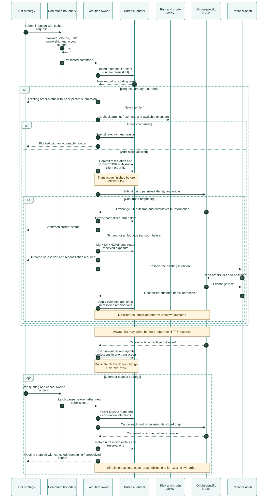

# Kalshi workstation architecture

This document distinguishes the **November 16 local reorganization**, the **November 11 prototype snapshot**, and the **proposed reliability overhaul**. Feature folders and shared transport/order helpers are implemented. Durable execution, central risk admission, unified simulation, and recovery guarantees remain plans.

The target is a trading workstation for one operator: one deployable application, one active execution owner, shared market data, durable order records and a clear operator interface. Existing FastAPI and browser technologies remain suitable. Each module below is a responsibility inside that application, not a separately deployed service.

The public baseline is `ce7bc284e4cd1634607feab6037166bca416b68b` in `sswadkar/kalshi-interface`. The expanded application was developed in a shared working prototype and reorganized on November 16, 2026. Public history and shared-project attribution are preserved; personal configuration and account history are excluded.

## Diagram index

Open the [offline diagram viewer](architecture.html) to switch between diagrams, zoom, and download SVGs. It embeds all seven diagrams and makes no network requests.

| Diagram | Question it answers | Editable source |
| --- | --- | --- |
| [Current organization](diagrams/07-reorganized.svg) | Where does the reorganized local code live? | [Mermaid](diagrams/07-reorganized.mmd) |
| [Before reorganization](diagrams/01-current.svg) | How was the November 11 prototype structured? | [Mermaid](diagrams/01-current.mmd) |
| [Proposed application](diagrams/02-proposed.svg) | Which component owns each responsibility? | [Mermaid](diagrams/02-proposed.mmd) |
| [Execution sequence](diagrams/03-execution.svg) | How does an intention become a tracked order? | [Mermaid](diagrams/03-execution.mmd) |
| [Order lifecycle](diagrams/04-order-lifecycle.svg) | How do partial fills, cancellation and uncertainty change state? | [Mermaid](diagrams/04-order-lifecycle.mmd) |
| [Startup and recovery](diagrams/05-runtime-recovery.svg) | When may the system trade, pause or exit? | [Mermaid](diagrams/05-runtime-recovery.mmd) |
| [Arbitrage planning](diagrams/06-arbitrage.svg) | When does a comparison justify a paired execution plan? | [Mermaid](diagrams/06-arbitrage.mmd) |

SVGs can be opened separately and zoomed without losing detail. The `.mmd` files are the editable sources. Arrows show calls or information flow; edge labels qualify their meaning. Blue marks the operator/API surface, green marks application logic, gold marks state or decisions, and red marks current gaps or blocked/unresolved outcomes.

## Implemented local reorganization — November 16, 2026


`src/kalshi_workstation/features/` contains trading, arbitrage, liquidity monitoring,
and liquidity provision. The shared `core/` contains exchange transport, existing
order helpers, a common mutation entry point, market books, positions, and portfolio
history. Core modules do not import features. `app.py` wires the routers, LP runner,
and shared program metadata. `runtime.py` owns five background tasks and awaits their
cancellation on shutdown. `server.py` is a compatibility launcher.

All 30 URLs, the browser pages, and the existing JSON file locations are retained.
Credentials are loaded at authenticated use instead of import. Tests run offline
with synthetic fixtures and an isolated data directory. Unused alternate clients, manual order scripts, and empty root scaffolding are excluded from this public application.

The execution entry point currently delegates to the existing exchange adapter;
features still retain their current mode checks and order state. This step does not
implement reservations, persistence, deduplication, or reconciliation. Existing
arbitrage economics, partial-fill handling, stale-book behavior, and LP stop/mode
issues remain. The public copy removes the former credential placeholders,
defaults the dashboard to dry run, and binds the compatibility launcher to loopback.
These defaults do not resolve the mode/cancellation inconsistencies.

## Before reorganization — November 11 snapshot

The following diagram and description record the prototype before the moves.
File names, task ownership, and the absence of tests in this subsection are historical.


The browser receives HTML from FastAPI and polls HTTP endpoints. Its JavaScript does not consume the exchange WebSocket directly. `server.py` combines routing, strategy configuration, arbitrage decisions, order execution, portfolio persistence and background-task startup. It contains 30 routes: 26 API endpoints and four HTML pages.

`kalshi_positions.py` mixes exchange authentication and HTTP transport with market, position and valuation logic. Its module import loads credentials and a private key. `liquidity_maker.py` owns the LP loop, calls exchange order helpers directly, keeps its own order/inventory state, and starts `liquidity_ws.py`. The stream maintains books and sends private order/fill callbacks back into the maker. `liquidity_analytics.py` combines live discovery/reads with scoring calculations.

There are several paths to exchange mutations: manual routes, the arbitrage executor, the order-reset route, and LP placement/cancellation/flattening. The shared dashboard/arbitrage dry-run flag and the LP dry-run flag are independent. The JSON files preserve some settings and history, but do not constitute an order/fill ledger.

| Background activity | Current owner | Timing in the code |
| --- | --- | --- |
| Markets, positions and balance | `server.poll_markets` | Work followed by a 0.5-second sleep |
| Resting orders and queue positions | `server.poll_resting_orders` | Work followed by a 3-second sleep |
| Arbitrage market reads and optional execution | `server.poll_arb_markets` | Sequential reads/execution followed by a 0.5-second sleep |
| LP quoting and checks | `LiquidityMaker.run` | Configured interval; default 1 second; program refresh about every 5 minutes |
| Account-wide reward estimates and portfolio history | `server.poll_lp_rewards` | Initial 25-second delay, then work followed by a 300-second sleep |
| Exchange stream | `LiquidityWS.run`, started by the maker | Event-driven; reconnect backoff on connection exceptions |

These sleep durations are not latency or freshness guarantees. Some reads use worker threads; some order paths still perform synchronous HTTP inside asynchronous handlers. The default launcher runs one process. Every additional application instance would create its own state and background tasks.

The dashboard and arbitrage page normally poll every two seconds. The liquidity page polls LP status every two seconds and the account-wide monitor every ten seconds. Performance history refreshes every thirty seconds. `index.html` currently registers its main refresh interval twice.

`clients.py` is an alternate client implementation that the current server/LP path does not import. `ping_tasks.py`, `trade_executor.py` and `utils.py` are empty. `test.py` is an executable demo-order script, not an automated test suite. They are intentionally outside the runtime diagram.

## Proposed application


**The execution service owns every order mutation.** Manual actions, arbitrage plans and LP quote decisions produce typed intentions. They cannot submit, replace or cancel orders through an exchange client directly. The execution service validates policy, reserves exposure, records the intention, chooses the correct broker and tracks its outcome.

The architecture has six boundaries:

| Boundary | Owns | Excludes |
| --- | --- | --- |
| API and browser | Input validation, operator actions, consistent status and read views | Strategy math and direct exchange writes |
| Domain logic | Order/price types, book calculations, payoff checks, fees, sizing and accounting rules | Network calls, credentials and file access |
| Market data | Feed subscriptions, normalized snapshots, timestamps, validity and gap recovery | Permission to trade |
| Execution and reconciliation | Order identity, lifecycle, reservations, duplicate handling, risk admission and recovery | Unqualified claims that a network timeout means rejection |
| Analytics | Portfolio observations, cash flows, reward estimates and their provenance | Treating projected rewards as confirmed cash |
| Adapters and storage | Kalshi protocol details, simulation, transactions and persistence | Independent strategy decisions |

The first deployment remains local to one operator. Bind the host-facing endpoint to loopback and validate allowed hosts/origins for browser mutations. Remote access requires a documented authenticated boundary. Exchange request signing and operator authentication remain separate responsibilities.

Market data is shared across features. A disconnected or invalid stream makes affected snapshots unusable for new exposure until recovery. REST can supply snapshots and reconciliation; its observations must carry freshness and source information too. The interface shows unavailable and stale states explicitly.

The lifecycle supervisor acquires an exclusive instance guard, starts tasks, observes failures and controls shutdown. This guard protects the supported single-host deployment. It is not distributed leader election and cannot prevent a separate host from trading the same account. One account executor is the deployment constraint; multi-node execution is deferred.

### Environment, execution mode and ownership

| Field | Meaning |
| --- | --- |
| Account environment | Kalshi demo or production |
| Execution mode | Simulated orders or real exchange orders |
| Data source | Offline fixtures/replay or a live feed |
| Strategy owner | Manual, arbitrage or LP, plus a stable strategy identity |
| Session and account identity | Scopes order IDs, fills, positions and persisted configuration |

A live-data simulation can read production market data while producing only simulated orders. An offline demo requires neither credentials nor network access. Real exchange orders can use a demo or production account. These distinctions should be visible to the operator.

Every order keeps its original context. Changing a setting cannot move a live order into simulated state. Existing live orders continue through their real cancellation/reconciliation path. Simulation and live accounting are separate. Starting a live session requires reconciliation and explicit arming; a simulation session never inherits live inventory implicitly. Offline mode constructs only replay and simulation adapters, so importing domain logic cannot load credentials.

### Storage and observability

Start with SQLite on a persistent local volume. It provides a local transactional store without adding a database service; Python exposes it through `sqlite3`. This is a proposed fit for the single-host scope, not a claim that persistence alone provides trading correctness. [Python SQLite documentation](https://docs.python.org/3/library/sqlite3.html)

Persist the smallest set needed for recovery: unique intentions, order state and origin, canonical fills, reservations, reconciliation checkpoints, strategy configuration, and portfolio/reward observations. Cash-flow observations and reward estimates retain their sources and timestamps. Position projections can be rebuilt from verified records and reconciled against the account. A fill insert and its accounting effects belong in the same transaction.

Use structured logs with intention ID, exchange order ID, strategy owner and operation outcome. Readiness reports include task health, data validity, last successful reconciliation and unresolved exposure. An alive process is not sufficient evidence that trading is ready. Credentials and private account data stay out of logs, fixtures, Git and container images. Risk admission uses confirmed account facts and conservative reservations; estimated rewards do not increase available trading capital.

## Execution and order lifecycle



Durable identity precedes network submission. The service records a stable client order ID and reservation before sending an order. It releases the database transaction before network I/O. On a repeated user request, it returns the existing intention's status rather than submitting again.

A crash between persistence and submission, or a timeout after submission, leaves an outcome to reconcile. An empty immediate lookup is insufficient evidence that the exchange never accepted the order. Keep the outcome unresolved and preserve the reservation until evidence or operator intervention resolves it. Do not assume an exchange deduplication guarantee beyond its verified API contract.

Private events may arrive before the HTTP response or be replayed after reconnect. Associate events using persisted identities; apply canonical fill IDs once. An acknowledgement's cumulative fill count informs order state, but must not be applied again as a separate inventory fill when canonical fills arrive. Event processing must tolerate that ordering and avoid regressing confirmed state.



Open orders, cancel-pending orders, unknown submissions and unmatched strategy exposure all affect admission decisions. Sending a cancel does not release reserved exposure. A canceled order can still have filled quantity, and late fill facts must remain reconcilable.

Pause takes effect before further new submissions. Requests already in flight may still be accepted, so the service continues tracking them. Cancellation and reconciliation have policies that remain usable when new trading is blocked by stale market data. The stop response reports quoting state separately from cancellation outcomes.

The intended guarantee is idempotent local accounting with explicit uncertainty and recovery. No cross-system exactly-once execution guarantee is claimed.

## Startup, pause and recovery



Live submission starts disabled. Read durable intentions and fetch paginated exchange orders, fills and positions; compare them before restoring authority to trade. Rebuild valid market snapshots and verify required tasks. Operator arming follows these checks.

On feed failure, ambiguous execution, limit breach or operator stop, pause new exposure and keep existing obligations visible. Resume only after reconciliation, valid data and explicit arming. During shutdown, bound the wait for cancellation and in-flight outcomes. Preserve unresolved records and tell the operator when exchange orders may remain live. Storage failure itself blocks new exposure and requires recovery; successful persistence cannot be promised during a disk failure.

Running multiple FastAPI workers would create independent application memory and startup tasks. The proposed first release explicitly supports one executor rather than using worker replication for availability. [FastAPI deployment documentation](https://fastapi.tiangolo.com/deployment/concepts/#memory-per-process)

## Arbitrage and liquidity decisions



An arbitrage group expresses a comparison, not proof of a payoff relationship. A supported relationship must be reviewed against settlement rules and represented explicitly. The planner checks all allowed outcomes for minimum combined payout, then subtracts cost at the actual limit prices, including quantity, fees, rounding and buffers. Unsupported or uncertain relationships remain analysis-only.

Paired execution uses the shared execution service. Reserve the plan's exposure before sending the first leg, size the second to confirmed fills, and re-evaluate whether it remains within the authorized price/exposure policy. Unmatched quantities are visible durable exposure. Recovery requires a pre-authorized bounded policy; it does not silently place an unlimited market order.

Kalshi's V2 order API specifies a ticker, quantity, price and time-in-force for an individual order. This design does not infer a cross-market atomic transaction from concurrent requests, batching or an individual order's fill-or-kill setting. [Kalshi order API](https://docs.kalshi.com/api-reference/orders/create-order-v2)

For LP, separate reward-model calculations from quote policy. Quote policy consumes valid books, program parameters and current inventory, then proposes changes. Execution owns exposure admission, actual placement, requeue/cancellation and tracking. Reward estimates carry the model version and unresolved assumptions; the architecture does not certify the current LP scoring assumptions.

## Repository organization and remaining boundaries

The current package groups code by feature. The logical boundaries in the proposed
architecture do not require separate global `domain/` and `services/` directories.
Keep feature-specific calculations beside their workflow, with shared execution,
market-data and exchange behavior in the core.

```text
src/kalshi_workstation/
  app.py
  config.py
  runtime.py
  pages.py
  features/
    trading/                # routes, polling, dashboard state
    arbitrage/              # routes, state, analysis, planner, polling
    liquidity_monitor/      # routes and read-only analysis
    liquidity_provider/     # routes, runner, extracted quote policy
  core/
    exchange/               # HTTP/signing, stream, incentive programs
    execution/              # existing order helpers and mutation entry point
    market_data.py          # market summaries and book reconstruction
    positions.py            # position calculations
    portfolio.py            # account value, JSON history, reward estimates
    liquidity.py            # shared reward-model calculations
    prices.py               # existing conversions and fee estimate
static/                     # four existing pages
tests/
  unit/
  integration/
  fixtures/
docs/
  architecture.md
  architecture.html
  build_viewer.py
  diagrams/
server.py                   # old launch commands remain supported
pyproject.toml              # package metadata, test/lint settings
requirements.txt            # dependency source read by pyproject.toml
.env.example
.gitignore
.dockerignore
Dockerfile
```

New files should appear with complete working changes. Add durable storage,
reconciliation, a simulation broker, or risk-policy modules when those behaviors
are implemented and verified; do not add empty placeholder modules. The existing
order encoding and fill parsing retain their known precision/state limitations.

| Before | Current destination | Remaining responsibility work |
| --- | --- | --- |
| `server.py` routes | Feature `routes.py` modules and `pages.py` | Typed validation and consistent action outcomes |
| Startup and polling | `runtime.py` and feature runners | Health supervision, arming and fault recovery |
| Order writes in server and LP | `core/execution/service.py` | Central admission, reservations, durable order ownership |
| Arbitrage logic | `features/arbitrage/` | Settlement validation, executable cost, bounded leg recovery |
| `liquidity_ws.py` | `core/exchange/stream.py`, `core/market_data.py` | Shared subscriptions and freshness enforcement |
| `liquidity_maker.py` | `features/liquidity_provider/` | Move authoritative order/account state into execution |
| `liquidity_analytics.py` | Monitor analysis, shared liquidity math, exchange program feed | Validate reward assumptions and provenance |
| `kalshi_positions.py` | Exchange, market data, positions, prices | Precise units and normalized account records |
| JSON settings/history | User-provided files, located through `config.py` | Explicit migration to durable records |

The existing single-process deployment is retained. Feature dictionaries still
contain mutable runtime state, and one execution entry point alone does not make
admission concurrency-safe. A supported restart/recovery policy remains future work.

## Migration and proof

| Milestone | Concrete change | Completion evidence |
| --- | --- | --- |
| 0. Reviewable baseline | Establish synthetic fixtures, safe runtime config, credential hygiene and source attribution | Offline checks require no keys; publication excludes private state |
| 1. Trustworthy stop | Preserve live orders across mode changes; make stop/cancel results accurate; introduce the execution boundary | Cancellation failure and in-flight-order tests; UI shows unresolved orders |
| 2. Durable accounting | Unique fill ingestion, persisted order identities/reservations, restart reconciliation | Duplicate replay does not alter inventory twice; crash/restart scenarios recover state |
| 3. Valid strategy plans | Explicit settlement relationships, limit/fee-aware cost, bounded paired execution; LP proposals use shared admission | Invalid payoff pairs are blocked; partial first/second-leg tests expose unmatched quantities |
| 4. Shared data and clear modules | Consolidate feeds and validity checks; extract remaining routes/calculations | Stale/gapped feed blocks new exposure; supported API behavior remains covered |
| 5. Reviewer and operator experience | Shared UI states, clean configuration, CI and deterministic demo | A reviewer can run the demo and reproduce an important failure without credentials |

Refactoring happens with each milestone. A move-only PR should not quietly alter trading behavior. Strategy automation stays disabled until its required invariants are verified. Secret removal from current files does not clean Git history; prepare the publication history separately with the repository owner.

The acceptance suite should cover:

- All four YES/NO buy/sell mappings, price/quantity units and supported tick sizes.
- Unsupported settlement relationships and edges that disappear after fees/buffers.
- Duplicate fills, out-of-order acknowledgement/fill delivery and terminal-order late fills.
- Submission timeout after acceptance, cancellation failure, and a fill racing cancellation.
- Crash before send, crash after send, and startup with unresolved orders or existing inventory.
- Mode changes with existing live orders; isolated simulated/live accounting.
- Stale market data, sequence gaps, task failures and rate limiting.
- Failed stop and bounded shutdown: unresolved orders remain visible and recoverable.
- Local access restrictions, input validation, and read endpoints that do not silently mutate history.

GitHub Actions runs the current unit and integration checks without live credentials. Future browser coverage should concentrate on consequential controls. Simulator results must report assumptions; they are not evidence of live execution quality or profitability. Measure data age, request latency and reconciliation lag under a stated workload before making performance claims.

## Current API surface

These 30 routes are preserved by the feature routers and `pages.py`. `tests/fixtures/routes.json` records the pre-move contract and the integration suite verifies it against the application OpenAPI schema.

| Surface | Current routes |
| --- | --- |
| Pages | `GET /`, `GET /arbitrage`, `GET /liquidity`, `GET /performance` |
| Dashboard and mode | `GET /api/status`, `PUT /api/settings/dry_run` |
| Manual execution | `POST /api/order/buy`, `POST /api/order/sell`, `GET /api/orders/resting`, `DELETE /api/orders/cancel/{order_id}`, `POST /api/orders/reset/{order_id}` |
| Account monitor | `GET /api/orders/all_resting` |
| Arbitrage status and configuration | `GET /api/arb/status`, `POST /api/arb/groups`, `PUT /api/arb/groups/{group_id}`, `DELETE /api/arb/groups/{group_id}`, `POST /api/arb/groups/{group_id}/markets`, `DELETE /api/arb/groups/{group_id}/markets/{ticker}`, `PUT /api/arb/settings` |
| Arbitrage execution | `POST /api/arb/execute` |
| LP status and analysis | `GET /api/lp/status`, `GET /api/lp/scan` |
| LP controls | `PUT /api/lp/settings`, `POST /api/lp/markets`, `PUT /api/lp/markets/{ticker}`, `DELETE /api/lp/markets/{ticker}`, `POST /api/lp/panic` |
| Reward inputs and history | `POST /api/lp/rewards/pending`, `POST /api/lp/rewards/baseline`, `GET /api/portfolio/history` |

The SVGs are generated documentation. The `.mmd` files are the sources to edit. This version was rendered with Mermaid CLI 12.2.0 and Mermaid 12.3.0 using an isolated Node 22 runtime. Rendering tools are documentation tooling and are not application dependencies.

For a configured Mermaid CLI installation, render each source with the shared configuration:

```bash
mmdc -i docs/diagrams/01-current.mmd -o docs/diagrams/01-current.svg -c docs/diagrams/mermaid-config.json -b white
```

Repeat for the other `.mmd` files, then regenerate the self-contained viewer:

```bash
python3 docs/build_viewer.py
```

Check label readability and compare the current-route inventory with the source before publishing. The November 16 update also reorganizes the local application and adds offline migration checks. Proposed execution guarantees remain unimplemented.
